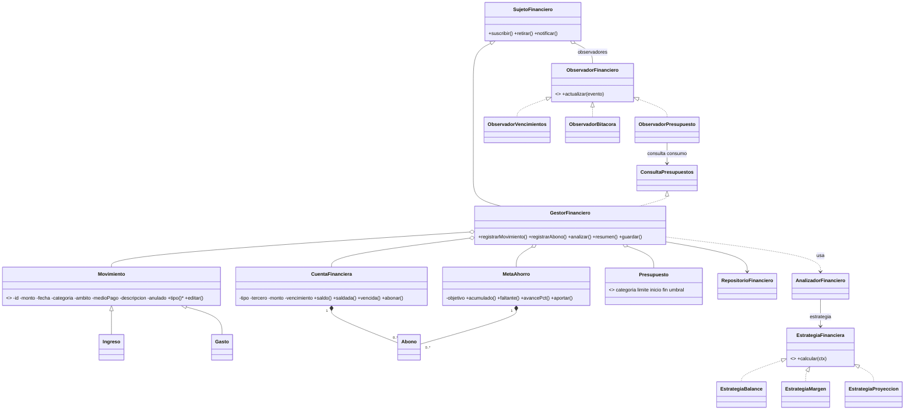

# Gestor Financiero Personal para Emprendedores Locales (Java)

Proyecto Final – Programación III, Universidad de Córdoba. Aplicación de consola en **Java 17+** con los
patrones **Strategy** y **Observer**. Sin dependencias en tiempo de ejecución (JUnit 5 solo para las pruebas).

## Ejecutar

**Con Maven** (el `pom.xml` es estándar):

```bash
mvn test                              # 37 pruebas JUnit 5
mvn compile exec:java                 # lanza el menú (datos en ./datos/gestor.json)
mvn package && java -jar target/gestor-financiero-1.0.0.jar
```

**Sin Maven** (solo JDK):

```bash
# Linux / macOS
mkdir -p out && javac -encoding UTF-8 -d out $(find src/main -name "*.java")
java -cp out gestor.Main
```
```powershell
# Windows (PowerShell)
mkdir out; javac -encoding UTF-8 -d out (Get-ChildItem -Recurse src/main -Filter *.java).FullName
java -cp out gestor.Main
```

Los datos se guardan automáticamente tras cada operación y al salir; la opción 10 además crea una copia en
`datos/respaldos/`. Cada evento queda en `datos/bitacora.log`. Ejecute siempre desde la misma carpeta, porque
`datos/` se crea en el directorio actual.

## Estructura

| Capa (sección 14) | Paquete / clase |
|---|---|
| Presentación | `gestor.consola.Consola` (menús y validación de entradas; sin cálculos) |
| Aplicación | `gestor.servicio.GestorFinanciero` (casos de uso; es el *Subject* del Observer), `Resumen` |
| Dominio | `gestor.dominio`: `Movimiento` (abstracta) → `Ingreso`/`Gasto`, `CuentaFinanciera`, `Abono`, `Presupuesto`, `MetaAhorro`, `Categoria` y enums `Ambito`, `MedioPago`, `TipoCuenta`, `TipoMovimiento` |
| Strategy | `gestor.estrategia`: `EstrategiaFinanciera` ← `EstrategiaBalance`/`Margen`/`Proyeccion`; `AnalizadorFinanciero` |
| Observer | `gestor.observador`: `ObservadorFinanciero` ← `ObservadorPresupuesto`/`Vencimientos`/`Bitacora`; `SujetoFinanciero`, `Evento` |
| Persistencia | `gestor.persistencia.RepositorioFinanciero` (JSON, escritura atómica) y `gestor.util.Json` |
| Excepciones | `gestor.excepcion.GestorException` y subclases anidadas |

## Diagrama de clases (UML)



**Strategy:** `AnalizadorFinanciero` recibe una `EstrategiaFinanciera` y delega; agregar un indicador es crear
otra clase que la implemente, sin tocar el analizador ni el gestor. **Observer:** `GestorFinanciero` publica
`Evento`s y los observadores suscritos reaccionan; se pueden retirar/agregar en ejecución (menú 6 → opción 3).

## Decisiones donde el documento dejaba margen

- **JSON propio** (`gestor.util.Json`, ~150 líneas) en vez de Gson/Jackson, para que el proyecto compile y corra sin
  dependencias. Tiene sus propias pruebas (`JsonTest`).
- **Mismo formato de datos que la versión Python:** el archivo `gestor.json` es byte a byte idéntico entre ambas
  versiones, así que se puede cambiar de una a otra sin migrar nada.
- **Dinero:** `BigDecimal` (nunca `double`), en COP.
- **`ConsultaPresupuestos`:** interfaz mínima que el observador de presupuestos usa para consultar al gestor, así el
  paquete `observador` no depende de `servicio`.
- **`ServicioMovimientos`/`ServicioCuentas`:** se fusionaron en `GestorFinanciero` (el documento permite ajustar
  nombres mientras se mantengan los patrones).
- **Anular** marca el movimiento (se conserva para trazabilidad) y deja de contar en todos los cálculos.
- **Alertas de presupuesto (RN-10):** una al cruzar el umbral y otra al cruzar el límite; no se repiten en cada gasto
  posterior. Solo se evalúan al *registrar* un gasto (editar un gasto no dispara alertas).
- **Proyección:** saldo inicial + todos los movimientos + cuentas por cobrar (suman) y por pagar (restan) con
  vencimiento en el horizonte (30 días por defecto), incluidas las ya vencidas.
- **Presupuesto:** cuenta los gastos de la categoría en su periodo, de ambos ámbitos.
- **Abonos:** no pueden superar el saldo. **Vencimientos:** "próxima a vencer" = 3 días o menos; se revisa al abrir
  el programa y al registrar una cuenta.

## Cobertura del plan de pruebas

PT-01…PT-10 están en `GestorFinancieroTest` (`pt01_…` a `pt10_…`). `ConsolaTest` ejecuta sesiones completas del menú
con entradas inválidas y reabre el programa para comprobar la persistencia; `JsonTest` cubre el lector/escritor JSON.
